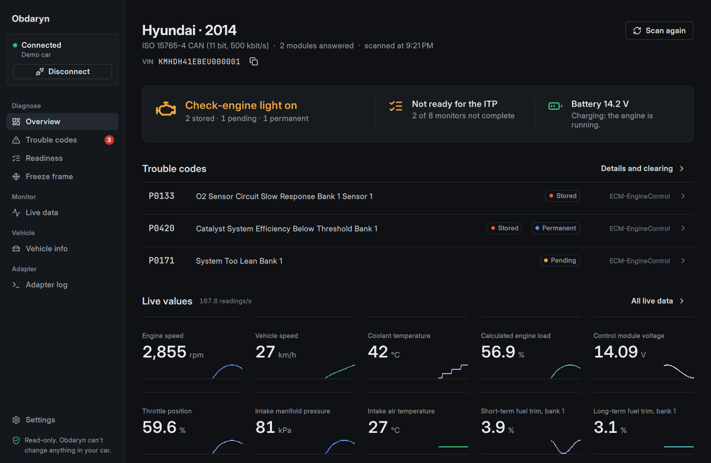
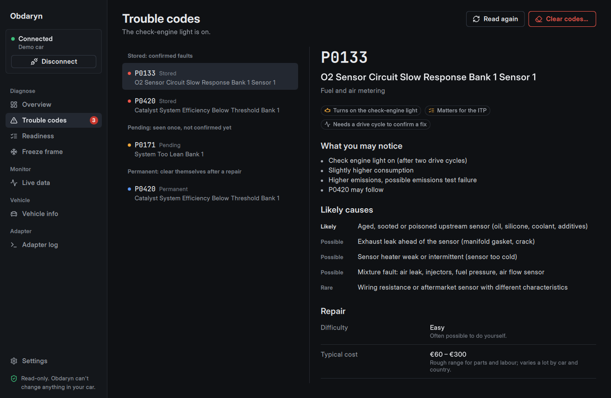
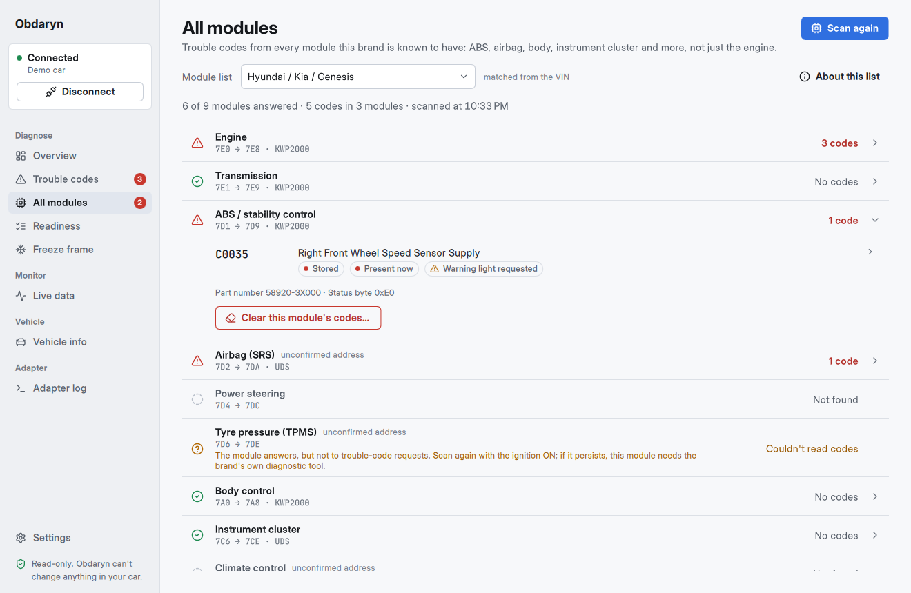

# Obdaryn

**Free, open-source, read-only OBD-II diagnostics for your car.** It is a desktop app for ELM327-compatible adapters such as the Vgate iCar Pro Wi-Fi.

- **Trouble codes in plain language.** Stored, pending and permanent codes from every OBD module, each with what it means, likely causes, symptoms, whether it matters for the inspection (ITP), and a rough repair cost.
- **Brand code explanations.** Manufacturer-specific codes are explained per brand, starting with Hyundai/Kia (177 sourced entries, English and Romanian), with links to the public sources.
- **All modules.** A full-vehicle scan reads codes from ABS, airbag, body, cluster and other modules too, using per-brand module lists: Hyundai/Kia, Toyota, Ford, VW group, Renault/Dacia, or generic for any car.
- **Readiness for inspection.** Which self-tests (monitors) have completed, and whether the car is likely to pass the emissions check.
- **Freeze frame.** The sensor snapshot taken when a fault was stored.
- **Live data.** Every standard sensor the car supports, with sparklines. A pinned dashboard refreshes several times per second thanks to multi-PID requests.
- **Vehicle info.** Decoded VIN, calibration IDs, CVNs and ECU names.
- **Clearing codes**, only when you ask, never with the engine running, and with the consequences explained first.
- **Adapter console.** Every command and answer, for troubleshooting.
- **English and Romanian**, switchable at runtime.







> **Read-only by design.** A safety guard checks every command and refuses anything that could write to, code, actuate, reset or flash a vehicle module. See [docs/CAR_INTERACTION.md](docs/CAR_INTERACTION.md).

Status: early development (v0.1). macOS first; Windows, Android and iOS will follow from the same Qt codebase. See [docs/ROADMAP.md](docs/ROADMAP.md).

## Build (macOS)

```bash
brew install qt cmake ninja
cmake -S . -B build -G Ninja -DCMAKE_BUILD_TYPE=Debug -DCMAKE_PREFIX_PATH="$(brew --prefix qt)"
cmake --build build
ctest --test-dir build --output-on-failure   # unit tests, no hardware needed
open build/src/app/Obdaryn.app
```

In CLion, open the folder and add `-DCMAKE_PREFIX_PATH=/opt/homebrew/opt/qt` to the CMake profile.

**No car nearby?** Choose **Try the demo car** on the connect screen, or run the Python ELM327 emulator (see [docs/CAR_INTERACTION.md](docs/CAR_INTERACTION.md#8-desk-testing-without-the-car)).

## Project layout

| Path | What it holds |
|---|---|
| `src/core` | Transport, ELM327 session, safety guard and OBD decoders (QtCore + QtNetwork only) |
| `src/app` | Qt Quick desktop app: controllers, models and QML screens |
| `tests` | Qt Test unit tests that run against recorded replies and the built-in simulator |
| `i18n` | Translations (`obdaryn_ro.ts`) |
| `tools` | Data import scripts (obdex DTC database) |
| `docs` | Architecture, car-interaction guide, roadmap |

Read [docs/ARCHITECTURE.md](docs/ARCHITECTURE.md) before contributing. Every source file is commented for newcomers.

## Licence and credits

Obdaryn is licensed under the **GNU General Public License v3.0 or later**; see [LICENSE](LICENSE). Third-party data and fonts are listed in [THIRD_PARTY.md](THIRD_PARTY.md).
