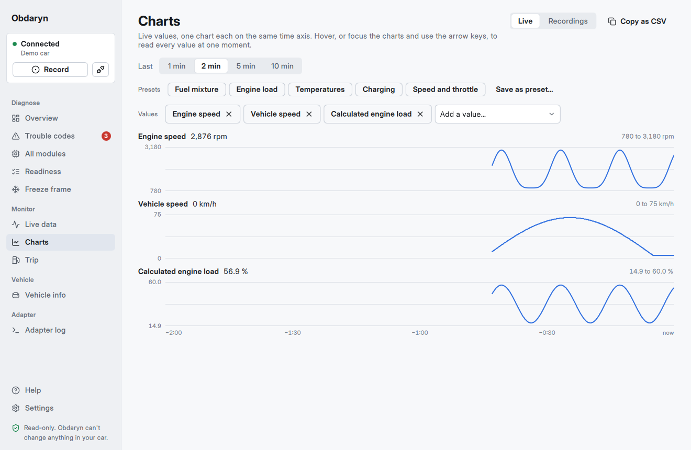
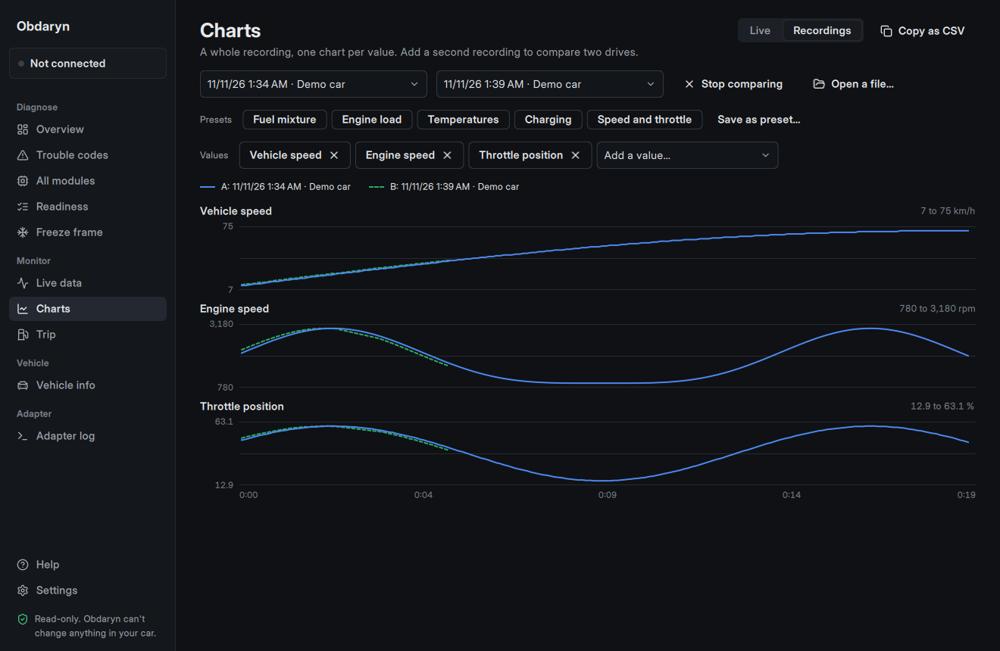
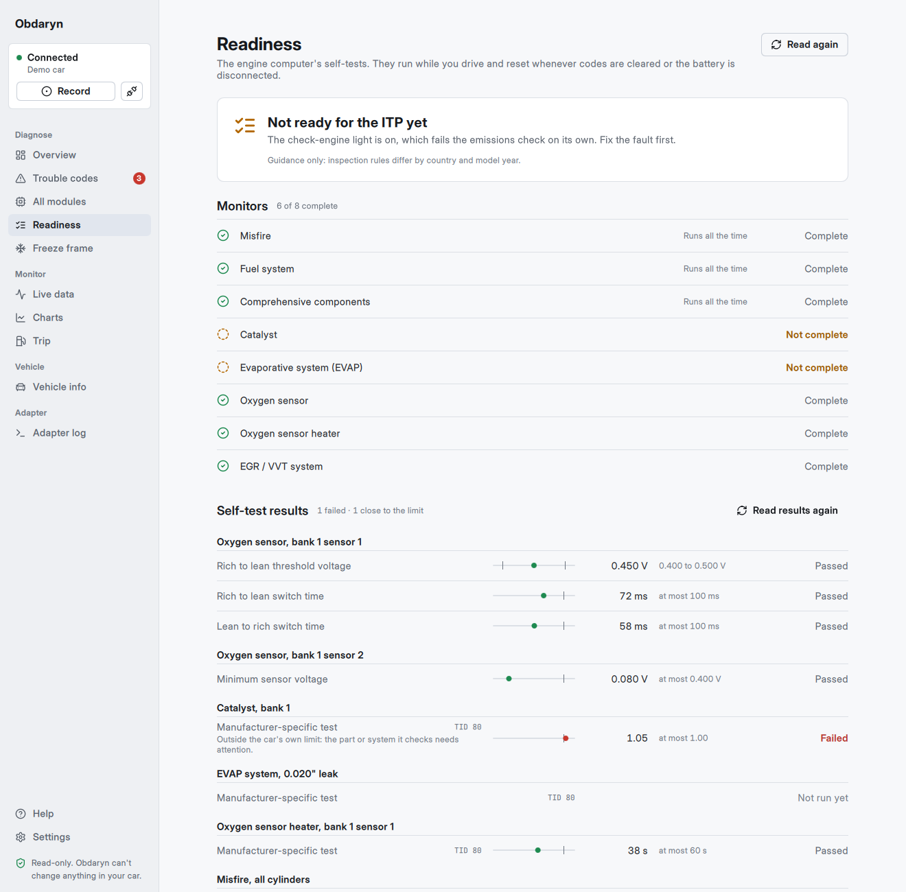
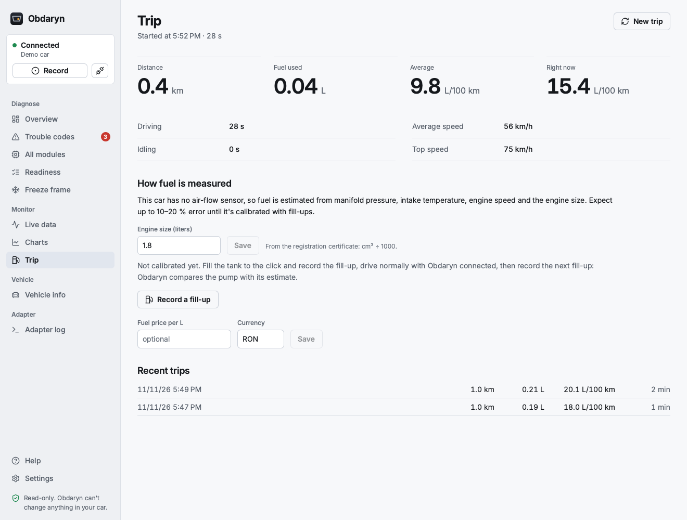

# Obdaryn

**Free, open-source, read-only OBD-II diagnostics for your car.** It is a desktop app for ELM327-compatible adapters such as the Vgate iCar Pro Wi-Fi.

- **Trouble codes in plain language.** Stored, pending and permanent codes from every OBD module, each with what it means, likely causes, symptoms, whether it matters for the inspection (ITP), and a rough repair cost. The same explanations are on the web, one page per code: [obdaryn.eu/codes](https://obdaryn.eu/codes/).
- **Brand code explanations.** Manufacturer-specific codes are explained per brand, with links to the public sources, in English and Romanian:
  - Hyundai/Kia (159 codes)
  - Toyota/Lexus (96)
  - Ford (62)
  - VW group (59)
  - Renault/Dacia (24)
  - Suzuki (23 engine and automatic-gearbox codes, 2005–2014 models)
- **All modules.** A full-vehicle scan reads codes from ABS, airbag, body, cluster and other modules too, using per-brand module lists: Hyundai/Kia, Toyota, Ford, VW group, Renault/Dacia, or generic for any car. For a brand with no list yet (Suzuki today), or a module the list misses, **Search every address** asks each diagnostic address whether a module is there (about a minute, only "are you there?" requests) and then reads the codes of whatever answered.
- **Readiness for inspection.** Which self-tests (monitors) have completed, and whether the car is likely to pass the emissions check.
- **Self-test results (Mode 06).** The numbers behind the readiness monitors, each next to the limits the car judges it by, so a part that's wearing out shows before the check-engine light comes on.
- **Freeze frame.** The sensor snapshot taken when a fault was stored.
- **Live data.** Every standard sensor the car supports, with sparklines. A pinned dashboard refreshes several times per second thanks to multi-PID requests.
- **Manufacturer values (Hyundai and Kia).** What the car's modules report beyond standard OBD-II, such as oil temperature, wheel speeds, steering angle or tyre pressures, from the community [OBDb](https://github.com/OBDb) definitions for 50+ models. Obdaryn asks each module once which values it answers, then reads only those.
- **Vehicle info.** Decoded VIN, calibration IDs, CVNs and ECU names.
- **Clearing codes**, only when you ask, never with the engine running, and with the consequences explained first.
- **Charts.** Several live values on a shared time axis, presets for common questions (mixture, load, temperatures, charging), and two recordings side by side to compare drives before and after a repair.
- **Trip computer.** Distance, fuel used, average and instant consumption, driving and idle time, with recent trips per car. Works on cars without an air-flow sensor too (many Hyundai, Kia and Toyota engines), from manifold pressure and the engine size, and learns a correction from your fill-ups.
- **Shareable report.** One PDF or web page with everything read from the car: a summary at a glance, every code explained, all modules, readiness, freeze frame and vehicle identification. Useful for a used-car check or to hand to a mechanic; it also shows how recently the codes were cleared, which on a car for sale deserves a question.
- **Record and replay.** Record a session (a drive, a fault that comes and goes) and replay it later without the car: every screen works as if it were connected. Export the live data as CSV for a spreadsheet.
- **Adapter health.** What your adapter really supports (most are ELM327-compatible clones, which is usually fine), how fast it answers, and automatic reconnection when the Wi-Fi link drops or the adapter falls asleep. When the ignition goes off, Obdaryn waits and picks up again by itself.
- **Adapter console.** Every command and answer, for troubleshooting.
- **English and Romanian**, switchable at runtime; metric, UK or US units.
- **Update check, if you want one.** Off until you turn it on in Settings: once a day Obdaryn asks obdaryn.eu for the newest version number and, when there is one, links to the download page. It installs nothing by itself.










> **Read-only by design.** A safety guard checks every command and refuses anything that could write to, code, actuate, reset or flash a vehicle module. See [docs/CAR_INTERACTION.md](docs/CAR_INTERACTION.md).
>
> **Private.** Obdaryn sends nothing about you or your car online. Its only internet request is the opt-in update check, which fetches one small file holding the newest version number ([privacy](https://obdaryn.eu/privacy/)).

Status: v0.4, in active development and not yet tested on a real car. macOS first; Android and iOS will follow from the same Qt codebase. See [docs/ROADMAP.md](docs/ROADMAP.md).

**Using it:** [docs/USER_GUIDE.md](docs/USER_GUIDE.md) (the same guide is in the app under **Help**, ⌘?) and [docs/CAR_INTERACTION.md](docs/CAR_INTERACTION.md) for what each feature asks of the car.

## Install (macOS)

Download the installer from **[obdaryn.eu](https://obdaryn.eu/download/)** or the [GitHub releases](https://github.com/liviu-hariton/obdaryn/releases). Open it and drag Obdaryn to Applications. The app isn't notarized, so the first time open it, then go to **System Settings → Privacy & Security** and click **Open Anyway**. It runs on macOS 14.4 (Sonoma) or later, on Apple Silicon and Intel: one installer of about 58 MB for both. To build the installer yourself: `tools/make-release.sh` (it needs the official Qt, not Homebrew's). Details in [docs/RELEASE.md](docs/RELEASE.md).

## Build (macOS)

```bash
brew install qt cmake ninja
cmake -S . -B build -G Ninja -DCMAKE_BUILD_TYPE=Debug -DCMAKE_PREFIX_PATH="$(brew --prefix qt)"
cmake --build build
ctest --test-dir build --output-on-failure   # unit tests, no hardware needed
open build/src/app/Obdaryn.app
```

In CLion, open the folder and add `-DCMAKE_PREFIX_PATH=/opt/homebrew/opt/qt` to the CMake profile.

**No car nearby?** Choose **Try the demo car** or replay a recording on the connect screen, or run the Python ELM327 emulator (see [docs/CAR_INTERACTION.md](docs/CAR_INTERACTION.md#8-desk-testing-without-the-car)).

## Project layout

| Path | What it holds |
|---|---|
| `src/core` | Transport, ELM327 session, safety guard and OBD decoders (QtCore + QtNetwork only) |
| `src/app` | Qt Quick desktop app: controllers, models and QML screens |
| `tests` | Qt Test unit tests that run against recorded replies and the built-in simulator |
| `i18n` | Translations (`obdaryn_ro.ts`) |
| `tools` | Data import scripts (obdex codes, OBDb values, Romanian code texts), the first real-car test (`first-contact.sh`), and the release, website and screenshot scripts (`make-release.sh`, `publish-release.sh`, `deploy-site.sh`, `capture-site-images.sh`, `capture-readme-images.sh`) |
| `docs` | Architecture, car-interaction guide, roadmap, user guide (English and Romanian) |
| `site` | The obdaryn.eu website (Astro, static), built from the app's own data, including a page per trouble code and an [`llms.txt`](https://obdaryn.eu/llms.txt) for AI agents; see [docs/RELEASE.md](docs/RELEASE.md#the-website) |

Read [docs/ARCHITECTURE.md](docs/ARCHITECTURE.md) before contributing. Every source file is commented for newcomers.

## Support

Obdaryn is free and stays free. If it saved you a trip to the workshop, you can [buy me a coffee](https://www.buymeacoffee.com/liviuhariton). Bug reports and pull requests are just as welcome: [issues](https://github.com/liviu-hariton/obdaryn/issues).

## Licence and credits

Copyright © 2026 Liviu Hariton and contributors.

Obdaryn is licensed under the **GNU General Public License v3.0 or later**; see [LICENSE](LICENSE). Third-party data and fonts are listed in [THIRD_PARTY.md](THIRD_PARTY.md).
